<div align="center">

# ❖ A . R . G . U . S 

```text
[SYSTEM BOOT] .......................... SUCCESS
[OPTICAL SENSORS] ...................... ONLINE
[VRAM CONSTRAINT] ...................... 8.0 GB STRICT
```

**Egocentric Video Understanding // Full-Duplex Edge AI // S2S**

[](https://github.com/) 
[](https://github.com/)
[](https://opensource.org/licenses/MIT)

</div>

> **A.R.G.U.S. is not a chatbot.** It is a continuous, multi-modal perception engine built to see what you see, hear what you hear, and respond in real-time. Engineered to process complex spatial reasoning, OCR, and full-duplex audio strictly on consumer edge hardware (8GB VRAM).

<br>

## ▓ SYSTEM ARCHITECTURE

The engine is built on a highly concurrent, zero-blocking FastAPI backend. Heavy tensor operations are isolated from I/O bounds using 5 parallel background daemons, ensuring the UI and WebSockets never drop frames.

* **Visual Cortex:** `Qwen2-VL-2B-Instruct` (4-bit nf4) + Custom 500GB Generalist LoRA.
* **Audio Cortex:** `faster-whisper` (base.en) + `edge-tts`.
* **Optical Ingestion:** `DXCam` (Desktop) / `OpenCV` (Webcam).

```mermaid
flowchart LR
    subgraph SENSORS [User Input]
        MIC(🎙️ Mic)
        CAM(📷 Camera)
    end
    
    subgraph ENGINE [A.R.G.U.S. Core]
        VAD[VAD / Echo Shield]
        ROUTER{Mode Router}
        MEM[(Ring Buffers)]
        LLM[Qwen2-VL]
    end
    
    subgraph OUTPUT [System Output]
        TTS(🔊 Speaker)
        UI(💻 Dashboard)
    end

    MIC --> VAD --> ROUTER
    CAM --> ROUTER
    ROUTER <--> MEM
    ROUTER --> LLM
    LLM --> TTS
    LLM --> UI
    
    style ENGINE fill:#0a0a0a,stroke:#333,stroke-width:1px,color:#fff
    style ROUTER fill:#1f1f1f,stroke:#fff
```



## ▓ FOUR-STATE PERCEPTION ROUTING

A.R.G.U.S. dynamically reallocates its attention, memory structures, and inference settings based on the active operational state.

* `[MODE 01] SCREEN COPILOT` // Engages high-FPS desktop capture. Acts as a real-time pair-programmer and UI analyst. Speaks in brief, casual bursts.
* `[MODE 02] LIVE COMPANION` // Egocentric webcam mode. Highly conversational, utilizing natural human speech fillers for fluid interaction.
* `[MODE 03] ASSISTIVE VISION` // Strips away conversational latency. Prioritizes aggressive physical hazard detection and dense OCR (reading medicine bottles). Overrides system to issue direct auditory warnings.
* `[MODE 04] SMART LECTURE` // Silent observer mode. Captures whiteboard snapshots every 60s and compiles continuous background transcripts. Merges audio/visual memory on-demand for post-class evaluation and tutoring.

## ▓ THE ECHO SHIELD & FULL DUPLEX

Standard AI voice agents suffer from acoustic feedback loops (hearing themselves speak). A.R.G.U.S. solves this with a proprietary **Software Echo Shield**.

* **Active Barge-in:** The mic is always hot. You can interrupt the AI at any millisecond; it immediately halts TTS and flushes the generation queue.
* **AEC Logic:** Using fuzzy matching (`difflib`) and substring validation, incoming microphone transcripts are continuously cross-referenced against a `deque` of the AI's recent outputs. Self-feedback is silently dropped. True human interruptions pass through.

## ▓ ZERO-RAM TRAINING PIPELINE 

The custom vision adapter was trained on **500GB of LLaVA-OneVision** entirely on a consumer GPU. The `train500.py` script is a masterclass in hardware optimization.

```python
# Streaming Parquet chunks without touching System RAM
load_dataset("parquet", data_dir=subset_dir, split="train", streaming=True)
```

* **Phased Checkpointing:** The dataset is partitioned into 100GB (10,000 step) phases. The script tracks progress via `resume_from_checkpoint`, allowing massive-scale training in interruptible batches.
* **Dimension Protection:** Bypasses Hugging Face batch-looping bugs by enforcing `batch_size=1` and overriding the Data Collator to format `features[0]` natively, protecting the 2D tensor shapes.
* **VRAM Safeguards:** Aggressive `torch.cuda.empty_cache()` sweeps and explicit variable deletion post-inference prevent VRAM fragmentation.

## ▓ INITIALIZATION SEQUENCE

**Prerequisites:** NVIDIA GPU ($\ge$ 8GB VRAM), 16GB System RAM, Python 3.10+.

```bash
# 01. Clone the repository
git clone [https://github.com/YourOrg/ARGUS.git](https://github.com/YourOrg/ARGUS.git)
cd ARGUS

# 02. Build the environment
python -m venv .venv
source .venv/bin/activate  # Windows: .venv\Scripts\activate

# 03. Install dependencies (Requires transformers >= 4.45.0)
pip install -r requirements.txt

# 04. Ignite the engine
python main.py
```

*Access the WebSocket Telemetry Dashboard at `http://localhost:8000`.*

---
<div align="center">
  <p><b>[ TELEMETRY ACTIVE ]</b> | VRAM Tracker • Core Temp • Latency Ms</p>
  <sub>MIT Licensed. Built for the edge by Anik and Aryan.</sub>
</div>
