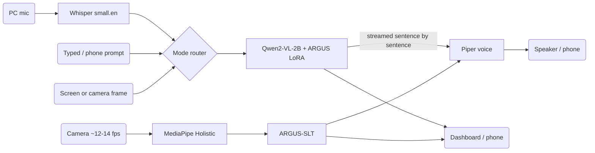

<div align="center">

# ❖ A . R . G . U . S

**Egocentric video understanding · speech in, speech out · sign language translation · runs offline on one consumer GPU**

[](#setup)
[](#models)
[](LICENSE)

</div>

A.R.G.U.S. sees what you see and answers out loud. A PC server runs a fine-tuned Qwen2-VL
vision-language model, Whisper speech recognition, a local Piper voice and the ARGUS-SLT
sign language translator. A web dashboard and an Android companion app
([A.R.G.U.S-Android](https://github.com/AryanAnjum/A.R.G.U.S-Android)) talk to it over WebSockets.

Developed and measured on an RTX 5060 Ti (16 GB) under Windows.

## Modes

| Mode | What it looks at | What it does |
| --- | --- | --- |
| **Screen** | This PC's screen (DXCam, MSS fallback) | Casual copilot for whatever is on screen |
| **Live** | Dashboard webcam or phone camera | Conversational companion |
| **Assistive** | Camera | Short, safety-first descriptions for a visually impaired user, hazard beep, Bangladeshi Taka reader |
| **Sign** | Camera | Translates continuous sign language into text and speech. German Sign Language (DGS) works now; Bangla (BdSL) switches on when its model is added |

**OCR on demand.** Everyday questions use a 1024 px image so they answer quickly. When you
turn on the **OCR** button, or ask something like *"read this"*, *"what does it say"*,
*"read the label"* or *"how much money is this"*, that one question is answered from a full
1920 px image with a reading-focused prompt. The phone takes a sharp still photo for it.

## How a reply flows



- **Streaming replies.** The model's answer is spoken one sentence at a time while the rest is
  still being generated, so you hear the start of the reply sooner.
- **Always listening.** The mic stays open while A.R.G.U.S. talks. *"Okay stop"* stops the voice and
  the generation at once, and a new question asked over it interrupts the old answer. It listens
  again the moment it stops talking. An echo filter ignores its own voice if you use loudspeakers.
- **Timing for every reply.** Each reply's stages (speech-to-text, first token, first sentence,
  voice synthesis, first audio, full reply) are shown on the dashboard and appended to
  `logs/latency.csv`, so latency figures come from real measurements.

## Models

- **Vision-language:** `Qwen/Qwen2-VL-2B-Instruct` in bf16 plus the ARGUS phased LoRA fine-tune
  (`argus_phased_adapters/part_5_adapter`, trained in five phases on a 500 GB LLaVA-OneVision
  subset with `train500.py`). The adapter is merged into the backbone at start-up.
- **Speech-to-text:** faster-whisper `small.en` on the GPU.
- **Voice:** [Piper](https://github.com/rhasspy/piper) (`en_US-ryan-medium`, `de_DE-thorsten-medium`),
  running locally. edge-tts (online) is the fallback.
- **Sign language:** ARGUS-SLT, see [`sign_language/README.md`](sign_language/README.md).
  On RWTH-PHOENIX-2014T it reaches test BLEU-4 20.54 ± 0.39 (3 seeds), above SignFormer-GCN's 19.75.

## Setup

**Prerequisites:** NVIDIA GPU with 8 GB or more of VRAM (16 GB recommended for sign language mode too), Python 3.10+, Windows for DXCam screen capture.

```bash
python -m venv ARGUS_venv
ARGUS_venv\Scripts\activate
pip install torch --index-url https://download.pytorch.org/whl/cu128   # RTX 50-series needs CUDA 12.8 builds
pip install -r requirements.txt
```

Put the fine-tune at `argus_phased_adapters/part_5_adapter` (or set `ARGUS_ADAPTER_PATH`), then:

```bash
cd src
python allnew.py
```

Open `http://localhost:8000`. In the Android app, enter `ws://<this PC's IP>:8000/ws` as the server address.

**First run needs internet once.** It downloads Qwen2-VL, Whisper, the Piper voices and the
MediaPipe holistic model. After that everything runs offline. The Piper voices go to
`models/piper/`, and you can copy the `.onnx` and `.onnx.json` files there by hand instead.

### Sign language mode

1. Copy the trained German checkpoint folder (the `best/` folder with `model.pt` and
   `vocab.json`) to `runs/ablation_small_decoder_s1/best`, or point `ARGUS_SLT_DE_CKPT` at it.
2. That model also uses RGB features, so put the BSL-1K I3D checkpoint at `models/bsl1k.pth.tar`
   (download link in `sign_language/README.md`, step 2b). A pose-only checkpoint doesn't need it.
3. Choose **Sign**, sign in front of the camera, then lower your hands. The sentence is
   translated after about a second without hands, or straight away with **Translate now**.

The German model was trained on PHOENIX-2014T, which is TV weather forecasts, so it translates
weather-style German signing best. **Bangla:** when the BdSL model finishes training, copy its
`best/` folder to `runs/bansign_small/best` (or set `ARGUS_SLT_BN_CKPT`) and restart. It then
shows up as ready in the language menu, with no code change.

### Settings (environment variables)

| Variable | Default | Meaning |
| --- | --- | --- |
| `ARGUS_ADAPTER_PATH` | `argus_phased_adapters/part_5_adapter` | LoRA fine-tune folder |
| `ARGUS_MAX_IMAGE_PX` | `1024` | Longest image side for normal questions |
| `ARGUS_OCR_MAX_PX` | `1920` | Longest image side for OCR questions |
| `ARGUS_PAUSE_THRESHOLD` | `0.45` | Seconds of silence that end a spoken question |
| `ARGUS_BARGE_IN` | `all` | While ARGUS talks: `all` = a new question interrupts it, `stop` = only "stop" / "goodbye" do |
| `ARGUS_ECHO_GUARD` | `0` | Seconds to wait after ARGUS stops before listening. Keep 0 with earphones; try 0.5-0.8 with loudspeakers |
| `ARGUS_TTS` | `piper` | `piper` (offline) or `edge` (online Microsoft voices) |
| `ARGUS_WHISPER_MODEL` | `small.en` | faster-whisper model |
| `ARGUS_SLT_DE_CKPT` / `ARGUS_SLT_BN_CKPT` | see above | Sign language checkpoints |
| `ARGUS_SLT_ENGLISH` | `1` | Also translate sign captions into English with Qwen |
| `ARGUS_SLT_SPEAK` | `en` | Speak captions in `en`, the `source` language, or `off` |
| `ARGUS_SLT_END_GAP` | `1.0` | Seconds without hands that end a signed sentence |
| `ARGUS_LATENCY_LOG` | `logs/latency.csv` | Where per-reply timings are written |

## Voice commands (PC mic)

- *"Hey Argus"*, optionally followed by a question, wakes it up.
- *"Read this"*, *"what does it say"* and *"how much money is this"* answer from the full-resolution image.
- *"Okay stop"* interrupts. *"Goodbye"* puts it back to sleep.

## Repository layout

```
src/allnew.py        server: models, mic, WebSocket API, modes
src/argus_slt.py     live sign language sessions (MediaPipe -> ARGUS-SLT)
src/argus_tts.py     Piper / edge-tts voices
src/new.html         dashboard (offline: no CDN fonts or icons)
sign_language/       ARGUS-SLT training and evaluation code
train500.py          phased LoRA training on the 500 GB dataset
a.py                 VLM benchmark
archive/             older server and dashboard versions, not used
```

---
<div align="center">
  <sub>MIT Licensed. Built by Anik and Aryan.</sub>
</div>
