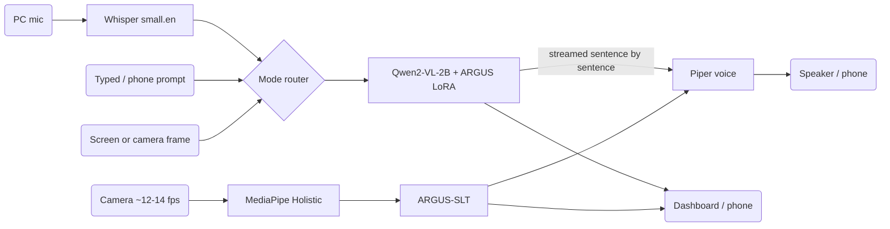

<div align="center">

# ❖ A . R . G . U . S

**Egocentric video understanding · speech in, speech out · sign language translation · runs offline on one consumer GPU**

[](#setup)
[](#models)
[](LICENSE)

</div>

A.R.G.U.S. sees what you see and answers out loud. A PC server runs a fine-tuned Qwen2-VL
vision-language model, Whisper speech recognition, a local Piper voice and the ARGUS-SLT
sign language translator. A web dashboard and an Android companion app
([A.R.G.U.S-Android](https://github.com/AryanAnjum/A.R.G.U.S-Android)) talk to it over WebSockets.

Developed and measured on an RTX 5060 Ti (16 GB) under Windows.

## Modes

| Mode | What it looks at | What it does |
| --- | --- | --- |
| **Screen** | This PC's screen (DXCam, MSS fallback). On a phone: that phone's own screen, never its camera | Casual copilot for whatever is on screen |
| **Live** | The chosen camera: PC webcam, head-mount camera or phone camera | Conversational companion |
| **Assistive** | Camera | Acts as the eyes of a blind user: walking guidance with directions and distances, a hands-free **Guide** mode, medicine label reader (name, strength, dose, expiry), hazard beep, Bangladeshi Taka reader |
| **Sign** | Camera | Translates continuous sign language into text and speech. German Sign Language (DGS) and Bangla Sign Language (BdSL) |

**OCR on demand.** Everyday questions use a 1024 px image so they answer quickly. When you
turn on the **OCR** button, or ask something like *"read this"*, *"what does it say"*,
*"read the label"* or *"how much money is this"*, that one question is answered from a full
1920 px image with a reading-focused prompt. The phone takes a sharp still photo for it.

## How a reply flows



- **Streaming replies.** The model's answer is spoken one sentence at a time while the rest is
  still being generated, so you hear the start of the reply sooner.
- **Always listening.** The mic stays open while A.R.G.U.S. talks. *"Okay stop"* stops the voice and
  the generation at once, and a new question asked over it interrupts the old answer. It listens
  again the moment it stops talking. An echo filter ignores its own voice if you use loudspeakers.
- **Timing for every reply.** Each reply's stages (speech-to-text, first token, first sentence,
  voice synthesis, first audio, full reply) are shown on the dashboard and appended to
  `logs/latency.csv`, so latency figures come from real measurements.

## Models

- **Vision-language:** `Qwen/Qwen2-VL-2B-Instruct` in bf16 plus the ARGUS phased LoRA fine-tune
  (`argus_phased_adapters/part_5_adapter`, trained in five phases on a 500 GB LLaVA-OneVision
  subset with `train500.py`). The adapter is merged into the backbone at start-up.
- **Speech-to-text:** faster-whisper `small.en` on the GPU.
- **Voice:** [Piper](https://github.com/rhasspy/piper) (`en_US-ryan-medium`, `de_DE-thorsten-medium`),
  running locally. edge-tts (online) is the fallback.
- **Sign language:** ARGUS-SLT, see [`sign_language/README.md`](sign_language/README.md).
  On RWTH-PHOENIX-2014T it reaches test BLEU-4 20.54 ± 0.39 (3 seeds), above SignFormer-GCN's 19.75.

## Setup

**Prerequisites:** NVIDIA GPU with 8 GB or more of VRAM (16 GB recommended for sign language mode too), Python 3.10+, Windows for DXCam screen capture.

```bash
python -m venv ARGUS_venv
ARGUS_venv\Scripts\activate
pip install torch --index-url https://download.pytorch.org/whl/cu128   # RTX 50-series needs CUDA 12.8 builds
pip install -r requirements.txt
```

Put the fine-tune at `argus_phased_adapters/part_5_adapter` (or set `ARGUS_ADAPTER_PATH`), then:

```bash
cd src
python argus_desktop.py
```

This opens A.R.G.U.S. as a desktop app in its own window (or double-click `ARGUS.bat`). A
loading screen shows each step while the models load, and closing the window stops the
backend. It is the same backend the phone uses, so the desktop app and the Android app can
be connected at the same time. Add `--browser` to use the default browser instead, or run
`python allnew.py` and open `http://localhost:8000` as before. 
### Connect a phone

The Android and iPhone apps are companions: they send your voice and the camera to this PC and
show and speak the answers. Every model runs on the PC, so the phone only needs to be on the
same Wi-Fi (or the PC on the phone's hotspot).

Press **Connect phone** at the top of the PC app. The panel shows:

- a **QR code** the phone app scans to connect,
- this PC's **address** to type in by hand (`<IP>:8000`, the app uses `ws://<IP>:8000/ws`),
- the **phones connected** right now and the mode each one is in.

The PC also announces itself on the network (Bonjour / mDNS, `_argus._tcp`), so the iPhone app
lists it under "PCs on this network" without typing anything. If a phone can't connect, allow
Python / A.R.G.U.S. through Windows Firewall on private networks. The code is in
`src/argus_connect.py`; it needs the small `segno` and `zeroconf` packages from `requirements.txt`,
and without them the panel still shows the address.

### Cameras: webcam, head-mount camera, phone

In Live, Assistive and Sign mode every device picks the camera it looks through:

| Where | Choices |
| --- | --- |
| PC app (dashboard / desktop app) | **Webcam** (the PC's own camera), **Head-mount** (the USB camera worn on the head), **Phone** (the connected phone's camera) |
| Phone app (Android, iPhone) | **Back**, **Front**, **Head-mount** |

The head-mount camera is a USB webcam (for example a Rapoo 1080p on a headband) plugged into the PC.
The server opens it itself (`src/argus_cameras.py`), so the phone can use it while you walk and
the phone shows its picture live. It is only switched on while somebody has Head-mount selected.
When the PC has more than one camera, choose which one is the head-mount camera in the menu under
the camera buttons (camera names need the optional `pygrabber` package; without it they show as
Camera 0, Camera 1). The choice is remembered in `argus_cameras.json`.

With **Phone** chosen on the PC, the PC's questions, walking guidance and sign language use the
phone's camera; the phone app keeps its camera on for that and sends about 8 pictures a second, so
the PC shows it as video. The live views (head-mount on a phone, phone or head-mount in the PC app)
ask the PC for "the next picture after the one I have", so they follow the camera without a timer. A question never silently falls back
to another camera: if the chosen one has no picture, ARGUS says which camera to check.

**Screen mode on a phone** looks at that phone's screen. Tap **Share screen** in the app (Android
asks for permission; on iPhone pick **ARGUS Screen** and press Start Broadcast), then open any app
and ask "Hey Argus, what's on my screen?".

### Language: English or Bengali

ARGUS can speak, answer and listen in **English** or **Bengali (বাংলা)** in **Assistive mode**:
walking guidance, answers, medicine and money reading, and its own messages. Screen, Live and Sign
mode always speak English, also with Bengali chosen (and walking guidance stays Bangla even when it
was started from another mode).

| Where | How to switch |
| --- | --- |
| PC app | **English / বাংলা** buttons at the top right |
| Phone app (Android, iPhone) | the **EN / বাং** chip at the top, or Settings → Language |
| By voice or typing | *"Argus, speak Bengali"* / *"speak English"* |

Each phone has its own language, and the PC app has its own, so one can be Bengali while the other
stays English. The choice is remembered.

How it works (`src/argus_language.py`): the vision model and the guidance rules keep working in
English. Just before a sentence is spoken to a Bengali listener in Assistive mode it is turned into
Bangla:

1. fixed sentences (mode names, guidance instructions such as "move a little to your left", error
   messages) come from a hand-written table, and obstacle warnings ("Careful! There is a car ahead
   of you") are built from a word list, so these need no model and are instant;
2. everything else, mainly the model's own answers, is translated sentence by sentence **online with
   Google Translate** while the PC has internet (about 0.2 s a sentence, and much better Bangla), and
   otherwise by the offline backup below. Set `ARGUS_TRANSLATE=offline` to never send text online.
3. **Offline backup: NLLB-200** (`facebook/nllb-200-distilled-600M`), which runs on this PC. It is
   only downloaded and loaded when online translation does not work (about 2.5 GB, once) and takes
   about 1.3 GB of VRAM. Every minute ARGUS tries online again. Until the backup is ready,
   answers stay in English and the app shows "Downloading Bengali… 40%". On a graphics card with
   less than 1.8 GB free (an 8 GB card with every other model loaded) it runs on the processor
   instead, which is a little slower per sentence and leaves the card to the other models.

**The one-time download** (only for the offline backup). ARGUS fetches the model itself into `models/nllb-200-distilled-600M/`
(and the offline Bangla voice into `models/mms-tts-ben/`), so the PC needs internet the first time
Bengali is chosen. If the connection drops, press **বাংলা** again and it continues where it stopped.
If the app says *"Bengali couldn't download"*, this PC cannot reach `huggingface.co`: check its
internet (a phone hotspot is fine), then press **বাংলা** again. For a PC without internet, copy those
two folders from a PC that has them. This download does not use the Hugging Face cache, so it also
works in the installed desktop app, which keeps the Hugging Face libraries offline. NLLB-200 is
published only as `pytorch_model.bin`, which the Hugging Face library refuses to open with PyTorch
older than 2.6, so after the download ARGUS rewrites it once as `model.safetensors` (same numbers,
about a minute). Nothing has to be upgraded.

The chat shows the Bangla sentence with the English answer below it in smaller text.

**Bangla voice.** Piper has no Bangla voice, so by default the Bangla is spoken with the online
Microsoft voice (edge-tts, needs internet). Without internet ARGUS switches by itself to the offline
MMS voice (`facebook/mms-tts-ben`, about 150 MB, fetched in the background the first time Bengali is
chosen; it sounds more robotic and is slower). Set `ARGUS_TTS_BN=mms` to always use the offline voice.
The black window shows which voice spoke and how long it took (`[TTS] Bangla voice: online, 640 ms`).
If it keeps saying *offline* on a PC with internet, update the online voice: `pip install -U edge-tts`.

**Sign mode** speaks English: Bangla signs are shown in Bangla and spoken in English, as before.

**Speaking Bangla.** In Assistive mode with Bengali chosen, ARGUS also understands spoken Bangla:

| Say | What happens |
| --- | --- |
| *"হেই আর্গাস"* (or *"Hey Argus"*) and a question in Bangla | the question is translated to English for the model, the answer is spoken in Bangla |
| *"পথ দেখাও"* / *"আমাকে গাইড করো"* | walking guidance starts |
| *"গাইড বন্ধ করো"* / *"আমি পৌঁছে গেছি"* | walking guidance stops |
| *"থামো"* / *"চুপ করো"* | ARGUS stops talking |
| *"আবার বলো"* | ARGUS repeats the last thing it said |
| *"বিদায়"* | ARGUS goes to sleep |
| *"ইংরেজিতে কথা বলো"* | back to English |

The English commands keep working too. On the PC microphone the Bangla is recognized online with
Google's speech recognition (the same service the SpeechRecognition library already uses), next to
Whisper, which still listens for "Hey Argus" and the English commands. Without internet the PC
microphone understands English only and says so. The phones use their own Bangla speech recognition
(Android: Google, `bn-BD`; iPhone: Apple's, when the iPhone has Bangla). Set `ARGUS_BANGLA_STT=off`
to keep the PC microphone English-only. Typed Bangla questions work in every mode.

While ARGUS is speaking Bangla on the PC, only stop words (*"থামো"*, *"okay stop"*) and *"goodbye"*
interrupt it, so it does not answer its own voice; wait for it to finish, or use earphones.

**First run needs internet once.** It downloads Qwen2-VL, Whisper, the Piper voices and the
MediaPipe holistic model. After that everything runs offline. The Piper voices go to
`models/piper/`, and you can copy the `.onnx` and `.onnx.json` files there by hand instead.

### Share it as a Windows installer

`installer/build_installer.ps1` turns your setup into an installer a friend can run on their
own PC, with no Python, internet or setup on their side. It bundles a private Python,
PyTorch (CUDA 12.8), the app and every model (your fine-tune, the sign language checkpoints,
Qwen2-VL-2B, Whisper, the Piper voices and MediaPipe), so every mode works offline.

Build it once on your Windows PC (needs internet, about 25 GB of free disk, 30 to 90 minutes):

```powershell
winget install JRSoftware.InnoSetup
powershell -ExecutionPolicy Bypass -File installer\build_installer.ps1 -AdapterDir D:\path\to\part_5_adapter
```

It writes `installer\dist\ARGUS-Setup.exe` plus several `ARGUS-Setup-*.bin` files (about
9 GB in total). Copy all of them into one folder on a USB drive or shared drive. Your friend
runs `ARGUS-Setup.exe`, which installs to their user folder without admin rights, adds a
Start menu and desktop icon, and installs the Visual C++ runtime and WebView2 if they are missing.

Your friend's PC needs Windows 10 or 11, an NVIDIA GPU with 8 GB or more of VRAM and a recent
driver (570 or newer), and about 15 GB of free disk. Their phone connects to
`ws://<their PC's IP>:8000/ws`, and Windows asks once to allow A.R.G.U.S. through the firewall.
Logs are written to `data\logs\argus.log` inside the install folder.

### Sign language mode

Two sign languages are supported: **German (DGS)** and **Bangla (BdSL)**. Pick one in the
language menu of Sign mode.

1. Keep the trained `best/` folders (each holds `model.pt` and `vocab.json`) under `runs/`.
   ARGUS uses the first one it finds for each language, preferring the pose-only models
   because they are the fastest live and work from the phone's keypoints too:

   | Language | Checkpoints tried, in order | Override |
   | --- | --- | --- |
   | German | `runs/ablation_pose_only/best`, `runs/ablation_small_decoder_s1/best` | `ARGUS_SLT_DE_CKPT` |
   | Bangla | `runs/bansign_signer_pose_s0/best`, `runs/bansign_signer_s0/best`, `runs/bansign_sentence_pose_s0/best`, `runs/bansign_sentence_s0/best` | `ARGUS_SLT_BN_CKPT` |

2. The RGB + pose models (`ablation_small_decoder_*`, `bansign_signer_s0`, `bansign_sentence_s0`)
   also need the BSL-1K I3D checkpoint at `models/bsl1k.pth.tar` (download link in
   `sign_language/README.md`, step 2b). The pose-only models don't.
3. Choose **Sign**, pick the language, sign in front of the camera, then lower your hands. The
   sentence is translated after about a second without hands, or straight away with **Translate now**.
   The caption shows the German or Bangla sentence with an English translation underneath, and
   the English is spoken (set `ARGUS_SLT_SPEAK=source` to speak the original language instead).

The German model was trained on PHOENIX-2014T (TV weather forecasts), so it translates
weather-style German signing best. The Bangla model was trained on Ban-Sign-Sent-9K and scores
52.1 BLEU-4 on signers it never saw in training (see `runs/bansign_results.md`). Bangla speech
uses edge-tts, which needs internet, because Piper has no Bangla voice yet.

### Settings (environment variables)

| Variable | Default | Meaning |
| --- | --- | --- |
| `ARGUS_ADAPTER_PATH` | `argus_phased_adapters/part_5_adapter` | LoRA fine-tune folder |
| `ARGUS_MAX_IMAGE_PX` | `1024` | Longest image side for normal questions |
| `ARGUS_OCR_MAX_PX` | `1920` | Longest image side for OCR questions |
| `ARGUS_PAUSE_THRESHOLD` | `1.0` | Seconds of silence that end a spoken question. Lower answers sooner but can cut you off mid-sentence |
| `ARGUS_MAX_NEW_TOKENS` | `384` | Longest reply (`ARGUS_OCR_MAX_NEW_TOKENS` = 448 for reading) |
| `ARGUS_TTS_RATE` / `ARGUS_ASSIST_TTS_RATE` | `+0%` | Voice speed, e.g. `-10%` slower, `+10%` faster |
| `ARGUS_GUIDE_INTERVAL` | `2.5` | Seconds between walking-guidance updates |
| `ARGUS_BARGE_IN` | `all` | While ARGUS talks: `all` = a new question interrupts it, `stop` = only "stop" / "goodbye" do |
| `ARGUS_ECHO_GUARD` | `0` | Seconds to wait after ARGUS stops before listening. Keep 0 with earphones; try 0.5-0.8 with loudspeakers |
| `ARGUS_TTS` | `piper` | `piper` (offline) or `edge` (online Microsoft voices) |
| `ARGUS_WHISPER_MODEL` | `small.en` | faster-whisper model |
| `ARGUS_SLT_DE_CKPT` / `ARGUS_SLT_BN_CKPT` | see above | Sign language checkpoints |
| `ARGUS_SLT_ENGLISH` | `1` | Also translate sign captions into English with Qwen |
| `ARGUS_SLT_SPEAK` | `en` | Speak captions translated into the listener's language (`en`), as signed (`source`), or not at all (`off`) |
| `ARGUS_SLT_MIN_CONF` | `35` | Sign captions below this confidence (%) say "I'm not sure, please sign again". 0 = off. Calibrate with `src/slt_test_video.py` |
| `ARGUS_SLT_END_GAP` | `1.0` | Seconds without hands that end a signed sentence |
| `ARGUS_LATENCY_LOG` | `logs/latency.csv` | Where per-reply timings are written |
| `ARGUS_HEAD_CAMERA` | `auto` | Which PC camera is the head-mount camera: `auto`, a number (`0`, `1`) or part of its name (`rapoo`). The PC app's menu overrides it |
| `ARGUS_HEAD_FPS` | `15` | Head-mount pictures per second handed to ARGUS |
| `ARGUS_HEAD_WIDTH` / `ARGUS_HEAD_HEIGHT` | `1920` / `1080` | Head-mount capture size (1080p keeps reading sharp) |
| `ARGUS_LANGUAGE` | `en` | Language a device starts with: `en` or `bn`. The apps' own choice overrides it |
| `ARGUS_TRANSLATE` | `auto` | `auto` (Google Translate online, NLLB on this PC when offline), `online`, or `offline` (never send text online) |
| `ARGUS_BANGLA_STT` | `bn-BD` | Language the PC microphone recognizes in Assistive mode with Bengali (Google, online); `off` keeps it English-only |
| `ARGUS_TRANSLATE_MODEL` | `facebook/nllb-200-distilled-600M` | Offline translation model for Bengali: a Hugging Face id (downloaded into `models/`) or a folder that already holds the model. `facebook/nllb-200-distilled-1.3B` translates better and needs about twice the VRAM |
| `ARGUS_TRANSLATE_DEVICE` | `auto` | `auto` (GPU when it has 1.8 GB free, else the processor), `cuda` or `cpu` (slower, frees VRAM) |
| `ARGUS_TRANSLATE_BEAMS` | `2` | Translation beam size; `1` is fastest |
| `ARGUS_TTS_BN` | `auto` | Bangla voice: `auto` (online Edge voice, offline MMS voice without internet), `edge` or `mms` |
| `ARGUS_EDGE_VOICE_BN` | `bn-BD-PradeepNeural` | Online Bangla voice (`bn-BD-NabanitaNeural` is the female one) |

## Voice commands (PC mic)

- *"Hey Argus"*, optionally followed by a question, wakes it up.
- *"Read this"*, *"what does it say"* and *"how much money is this"* answer from the full-resolution image.
- *"Guide me"* (or *"help me walk"*) turns on walking guidance in Assistive mode: every few seconds it says
  what matters for your next steps, and stays quiet while the path is clear. *"Stop guiding"* or
  *"I have arrived"* ends it.
- In Assistive mode, questions about a medicine (*"what is this medicine"*, *"when does it expire"*)
  read the label from the full-resolution image and never guess a name or dose.
- *"Switch to assistive / live / screen / sign mode"* changes mode by voice (or typed), like the buttons.
  Add *"and turn on guide mode"* for walking guidance, or say *"Bangla sign mode"* / *"German sign mode"*.
- *"Speak Bengali"* / *"speak English"* (also *"switch language to Bengali"*) changes the language ARGUS speaks.
- *"Say that again"* (or *"repeat that"*, *"what did you say"*) repeats the last reply.
- *"Okay stop"* interrupts (and ends guidance). *"Goodbye"* puts it back to sleep.

## Repository layout

```
src/allnew.py        server: models, mic, WebSocket API, modes
src/argus_slt.py     live sign language sessions (MediaPipe -> ARGUS-SLT)
src/argus_tts.py     Piper / edge-tts voices, Bangla voice (edge-tts online, MMS offline)
src/argus_language.py  English / Bengali: fixed Bangla sentences, online and NLLB translation, Bangla commands
src/argus_connect.py Connect phone: PC address, QR code, network discovery
src/argus_cameras.py head-mount camera (USB webcam on the PC) shared with the phones
src/slt_test_video.py  run sign videos through the live pipeline, prints captions + confidence
src/new.html         dashboard (offline: no CDN fonts or icons)
sign_language/       ARGUS-SLT training and evaluation code
train500.py          phased LoRA training on the 500 GB dataset
a.py                 VLM benchmark
archive/             older server and dashboard versions, not used
```

---
<div align="center">
  <sub>MIT Licensed. Built by Anik and Aryan.</sub>
</div>
