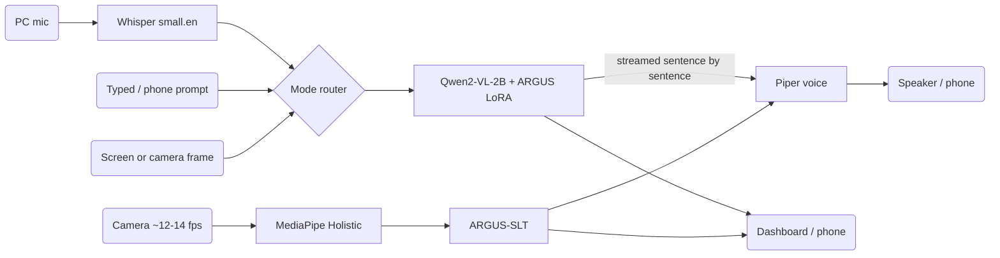

<div align="center">

# ❖ A . R . G . U . S

**Egocentric video understanding · speech in, speech out · sign language translation · runs offline on one consumer GPU**

[](#setup)
[](#models)
[](LICENSE)

</div>

A.R.G.U.S. sees what you see and answers out loud. A PC server runs a fine-tuned Qwen2-VL
vision-language model, Whisper speech recognition, a local Piper voice and the ARGUS-SLT
sign language translator. A web dashboard and an Android companion app
([A.R.G.U.S-Android](https://github.com/AryanAnjum/A.R.G.U.S-Android)) talk to it over WebSockets.

Developed and measured on an RTX 5060 Ti (16 GB) under Windows.

## Modes

| Mode | What it looks at | What it does |
| --- | --- | --- |
| **Screen** | This PC's screen (DXCam, MSS fallback) | Casual copilot for whatever is on screen |
| **Live** | Dashboard webcam or phone camera | Conversational companion |
| **Assistive** | Camera | Short, safety-first descriptions for a visually impaired user, hazard beep, Bangladeshi Taka reader |
| **Sign** | Camera | Translates continuous sign language into text and speech. German Sign Language (DGS) and Bangla Sign Language (BdSL) |

**OCR on demand.** Everyday questions use a 1024 px image so they answer quickly. When you
turn on the **OCR** button, or ask something like *"read this"*, *"what does it say"*,
*"read the label"* or *"how much money is this"*, that one question is answered from a full
1920 px image with a reading-focused prompt. The phone takes a sharp still photo for it.

## How a reply flows



- **Streaming replies.** The model's answer is spoken one sentence at a time while the rest is
  still being generated, so you hear the start of the reply sooner.
- **Always listening.** The mic stays open while A.R.G.U.S. talks. *"Okay stop"* stops the voice and
  the generation at once, and a new question asked over it interrupts the old answer. It listens
  again the moment it stops talking. An echo filter ignores its own voice if you use loudspeakers.
- **Timing for every reply.** Each reply's stages (speech-to-text, first token, first sentence,
  voice synthesis, first audio, full reply) are shown on the dashboard and appended to
  `logs/latency.csv`, so latency figures come from real measurements.

## Models

- **Vision-language:** `Qwen/Qwen2-VL-2B-Instruct` in bf16 plus the ARGUS phased LoRA fine-tune
  (`argus_phased_adapters/part_5_adapter`, trained in five phases on a 500 GB LLaVA-OneVision
  subset with `train500.py`). The adapter is merged into the backbone at start-up.
- **Speech-to-text:** faster-whisper `small.en` on the GPU.
- **Voice:** [Piper](https://github.com/rhasspy/piper) (`en_US-ryan-medium`, `de_DE-thorsten-medium`),
  running locally. edge-tts (online) is the fallback.
- **Sign language:** ARGUS-SLT, see [`sign_language/README.md`](sign_language/README.md).
  On RWTH-PHOENIX-2014T it reaches test BLEU-4 20.54 ± 0.39 (3 seeds), above SignFormer-GCN's 19.75.

## Setup

**Prerequisites:** NVIDIA GPU with 8 GB or more of VRAM (16 GB recommended for sign language mode too), Python 3.10+, Windows for DXCam screen capture.

```bash
python -m venv ARGUS_venv
ARGUS_venv\Scripts\activate
pip install torch --index-url https://download.pytorch.org/whl/cu128   # RTX 50-series needs CUDA 12.8 builds
pip install -r requirements.txt
```

Put the fine-tune at `argus_phased_adapters/part_5_adapter` (or set `ARGUS_ADAPTER_PATH`), then:

```bash
cd src
python argus_desktop.py
```

This opens A.R.G.U.S. as a desktop app in its own window (or double-click `ARGUS.bat`). A
loading screen shows each step while the models load, and closing the window stops the
backend. It is the same backend the phone uses, so the desktop app and the Android app can
be connected at the same time. Add `--browser` to use the default browser instead, or run
`python allnew.py` and open `http://localhost:8000` as before. In the Android app, enter `ws://<this PC's IP>:8000/ws` as the server address.

**First run needs internet once.** It downloads Qwen2-VL, Whisper, the Piper voices and the
MediaPipe holistic model. After that everything runs offline. The Piper voices go to
`models/piper/`, and you can copy the `.onnx` and `.onnx.json` files there by hand instead.

### Share it as a Windows installer

`installer/build_installer.ps1` turns your setup into an installer a friend can run on their
own PC, with no Python, internet or setup on their side. It bundles a private Python,
PyTorch (CUDA 12.8), the app and every model (your fine-tune, the sign language checkpoints,
Qwen2-VL-2B, Whisper, the Piper voices and MediaPipe), so every mode works offline.

Build it once on your Windows PC (needs internet, about 25 GB of free disk, 30 to 90 minutes):

```powershell
winget install JRSoftware.InnoSetup
powershell -ExecutionPolicy Bypass -File installer\build_installer.ps1 -AdapterDir D:\path\to\part_5_adapter
```

It writes `installer\dist\ARGUS-Setup.exe` plus several `ARGUS-Setup-*.bin` files (about
9 GB in total). Copy all of them into one folder on a USB drive or shared drive. Your friend
runs `ARGUS-Setup.exe`, which installs to their user folder without admin rights, adds a
Start menu and desktop icon, and installs the Visual C++ runtime and WebView2 if they are missing.

Your friend's PC needs Windows 10 or 11, an NVIDIA GPU with 8 GB or more of VRAM and a recent
driver (570 or newer), and about 15 GB of free disk. Their phone connects to
`ws://<their PC's IP>:8000/ws`, and Windows asks once to allow A.R.G.U.S. through the firewall.
Logs are written to `data\logs\argus.log` inside the install folder.

### Sign language mode

Two sign languages are supported: **German (DGS)** and **Bangla (BdSL)**. Pick one in the
language menu of Sign mode.

1. Keep the trained `best/` folders (each holds `model.pt` and `vocab.json`) under `runs/`.
   ARGUS uses the first one it finds for each language, preferring the pose-only models
   because they are the fastest live and work from the phone's keypoints too:

   | Language | Checkpoints tried, in order | Override |
   | --- | --- | --- |
   | German | `runs/ablation_pose_only/best`, `runs/ablation_small_decoder_s1/best` | `ARGUS_SLT_DE_CKPT` |
   | Bangla | `runs/bansign_signer_pose_s0/best`, `runs/bansign_signer_s0/best`, `runs/bansign_sentence_pose_s0/best`, `runs/bansign_sentence_s0/best` | `ARGUS_SLT_BN_CKPT` |

2. The RGB + pose models (`ablation_small_decoder_*`, `bansign_signer_s0`, `bansign_sentence_s0`)
   also need the BSL-1K I3D checkpoint at `models/bsl1k.pth.tar` (download link in
   `sign_language/README.md`, step 2b). The pose-only models don't.
3. Choose **Sign**, pick the language, sign in front of the camera, then lower your hands. The
   sentence is translated after about a second without hands, or straight away with **Translate now**.
   The caption shows the German or Bangla sentence with an English translation underneath, and
   the English is spoken (set `ARGUS_SLT_SPEAK=source` to speak the original language instead).

The German model was trained on PHOENIX-2014T (TV weather forecasts), so it translates
weather-style German signing best. The Bangla model was trained on Ban-Sign-Sent-9K and scores
52.1 BLEU-4 on signers it never saw in training (see `runs/bansign_results.md`). Bangla speech
uses edge-tts, which needs internet, because Piper has no Bangla voice yet.

### Settings (environment variables)

| Variable | Default | Meaning |
| --- | --- | --- |
| `ARGUS_ADAPTER_PATH` | `argus_phased_adapters/part_5_adapter` | LoRA fine-tune folder |
| `ARGUS_MAX_IMAGE_PX` | `1024` | Longest image side for normal questions |
| `ARGUS_OCR_MAX_PX` | `1920` | Longest image side for OCR questions |
| `ARGUS_PAUSE_THRESHOLD` | `0.45` | Seconds of silence that end a spoken question |
| `ARGUS_BARGE_IN` | `all` | While ARGUS talks: `all` = a new question interrupts it, `stop` = only "stop" / "goodbye" do |
| `ARGUS_ECHO_GUARD` | `0` | Seconds to wait after ARGUS stops before listening. Keep 0 with earphones; try 0.5-0.8 with loudspeakers |
| `ARGUS_TTS` | `piper` | `piper` (offline) or `edge` (online Microsoft voices) |
| `ARGUS_WHISPER_MODEL` | `small.en` | faster-whisper model |
| `ARGUS_SLT_DE_CKPT` / `ARGUS_SLT_BN_CKPT` | see above | Sign language checkpoints |
| `ARGUS_SLT_ENGLISH` | `1` | Also translate sign captions into English with Qwen |
| `ARGUS_SLT_SPEAK` | `en` | Speak captions in `en`, the `source` language, or `off` |
| `ARGUS_SLT_END_GAP` | `1.0` | Seconds without hands that end a signed sentence |
| `ARGUS_LATENCY_LOG` | `logs/latency.csv` | Where per-reply timings are written |

## Voice commands (PC mic)

- *"Hey Argus"*, optionally followed by a question, wakes it up.
- *"Read this"*, *"what does it say"* and *"how much money is this"* answer from the full-resolution image.
- *"Okay stop"* interrupts. *"Goodbye"* puts it back to sleep.

## Repository layout

```
src/allnew.py        server: models, mic, WebSocket API, modes
src/argus_slt.py     live sign language sessions (MediaPipe -> ARGUS-SLT)
src/argus_tts.py     Piper / edge-tts voices
src/new.html         dashboard (offline: no CDN fonts or icons)
sign_language/       ARGUS-SLT training and evaluation code
train500.py          phased LoRA training on the 500 GB dataset
a.py                 VLM benchmark
archive/             older server and dashboard versions, not used
```

---
<div align="center">
  <sub>MIT Licensed. Built by Anik and Aryan.</sub>
</div>
